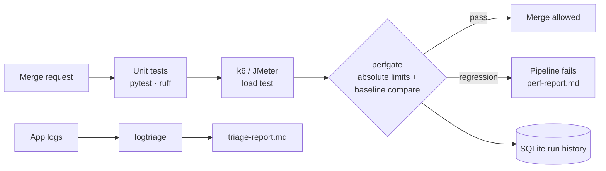

# Performance Regression Gate and Log Triage

[](https://github.com/jefflenard007-JJ/perf-gate-log-triage/actions/workflows/ci.yml)

Two small, dependency-free Python tools that plug into CI/CD:

- **`perfgate`** reads JMeter (`.jtl`) or k6 results, checks them against absolute SLO limits **and** a stored baseline, records every run in SQLite, and fails the pipeline when latency, errors or throughput regress.
- **`logtriage`** reads application logs (JSON or plain text), finds error spikes against a rolling baseline, groups errors by normalised signature, and writes a short root cause summary.

Load tests target `shop-api` from the companion [reliability-platform](https://github.com/jefflenard007-JJ/reliability-platform) project.



## Why a baseline as well as limits?

An absolute limit alone misses slow decay. In the bundled sample data, `POST /orders` p95 goes from 175 ms to 285 ms, which is still under the 300 ms SLO, so a limit-only check passes. Against the baseline it's a **+63%** regression, and the gate fails it:

```
❌ POST /orders: p95 vs baseline: p95 175 → 285 ms (+62.9%, tolerance +15%)
```

## Quick start

Python 3.11+, no third-party packages needed to run.

```bash
pip install -e ".[dev]"          # optional: installs the perfgate / logtriage commands and test tools
python scripts/make_sample_data.py

# Performance gate
python -m perfgate.cli check sample_data/current-good.jtl      --baseline baselines/orders-api.json   # exit 0
python -m perfgate.cli check sample_data/current-regressed.jtl --baseline baselines/orders-api.json   # exit 1
python -m perfgate.cli check sample_data/current-good.jtl --baseline baselines/orders-api.json --db perf-history.db
python -m perfgate.cli trend --db perf-history.db

# Log triage
python -m logtriage.cli sample_data/app.log --report triage-report.md
kubectl logs deploy/shop-api --since=2h | python -m logtriage.cli -
```

Sample triage output on the bundled log (a database connection pool exhaustion incident):

```
## Spike 1: 09:40 – 09:45
- Peak 45 errors/min vs baseline 0.27 errors/min
- Services: shop-api (180), payments (29)
- Likely cause: `Timeout acquiring DB connection from pool <str> after <n> ms (active=<n>, max=<n>)`
  accounts for 86% of errors in this window. It first appeared during this spike.
```

## Running real load tests

```bash
# k6
k6 run -e BASE_URL=http://localhost:8000 --summary-export=k6-summary.json loadtests/k6/orders-load.js
python -m perfgate.cli check k6-summary.json --baseline baselines/k6-orders.json --config perfgate.config.json

# JMeter
jmeter -n -t loadtests/jmeter/orders-load.jmx -JHOST=localhost -JPORT=8000 -JUSERS=20 -JDURATION=120 \
  -Jjmeter.save.saveservice.output_format=csv -l results.jtl
python -m perfgate.cli check results.jtl --baseline baselines/orders-api.json --config perfgate.config.json
```

The first time against a real service, save a healthy run as the baseline:
`python -m perfgate.cli update-baseline k6-summary.json --baseline baselines/k6-orders.json`

## How it works

| Piece | Path | Notes |
|---|---|---|
| Result parsing | `perfgate/results.py` | JTL CSV per endpoint plus an `ALL` row; k6 summary JSON; nearest-rank percentiles |
| Gate rules | `perfgate/gate.py`, `perfgate.config.json` | p95 and error-rate limits, p95 regression and throughput-drop tolerances, minimum sample size |
| Run history | `perfgate/history.py` | SQLite `runs` and `endpoint_stats` tables; trend query in plain SQL |
| Log parsing | `logtriage/parser.py` | JSON lines and `timestamp LEVEL [service] message`; UUIDs, IPs, numbers and strings normalised into signatures |
| Spike detection | `logtriage/analyze.py` | Per-minute error counts vs mean + 3σ of the last 15 *normal* minutes, so a long incident isn't absorbed into its own baseline |
| CI | `.github/workflows/ci.yml`, `Jenkinsfile` | GitHub Actions: unit tests, gate self-test, k6 against the app as a service container, gate, triage. Jenkins: JMeter version |

## Tests

```bash
pytest -q --cov=perfgate --cov=logtriage
```
